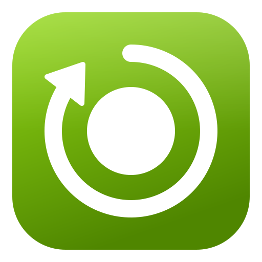
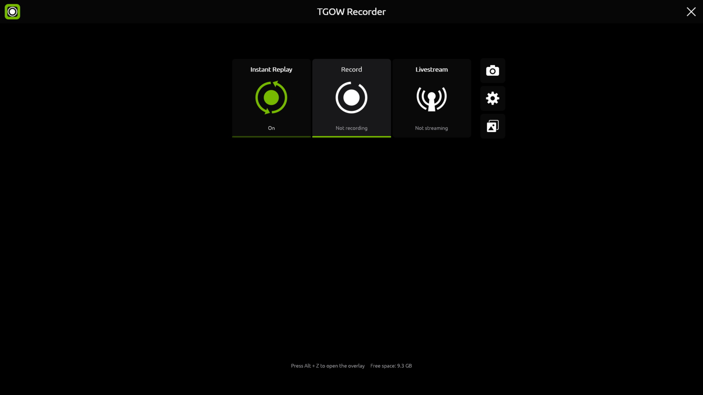
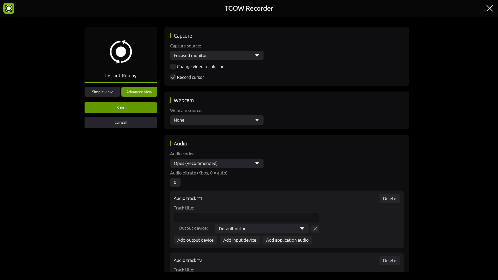
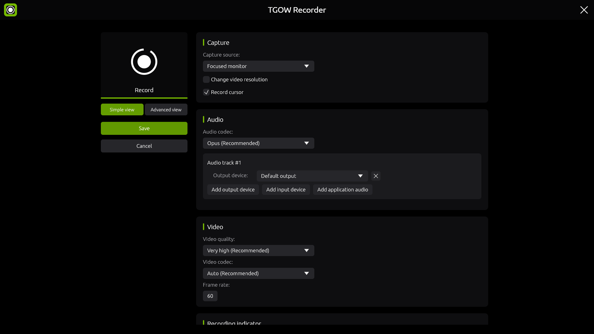
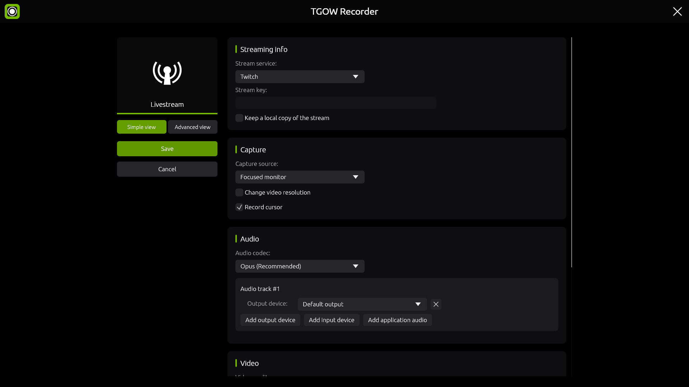
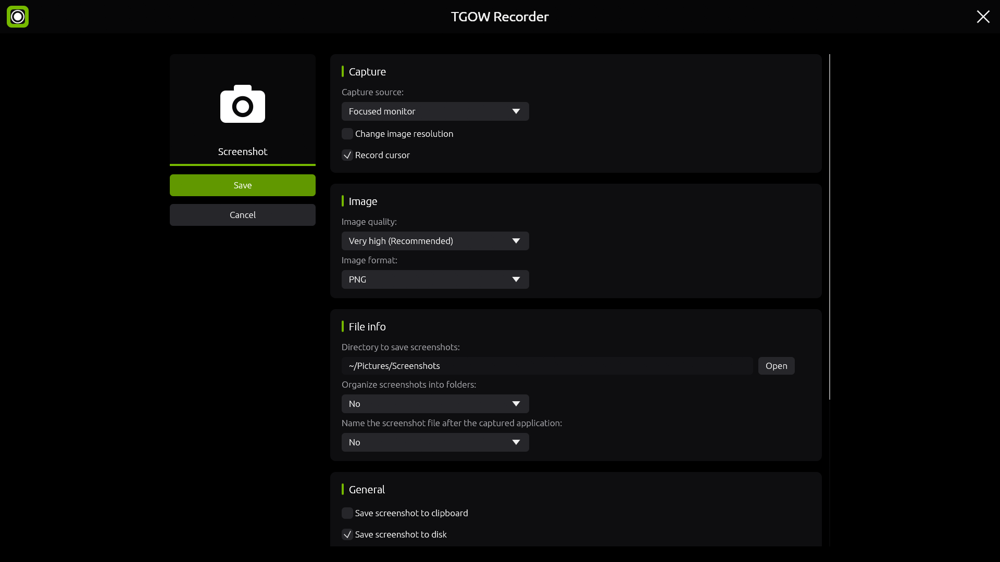
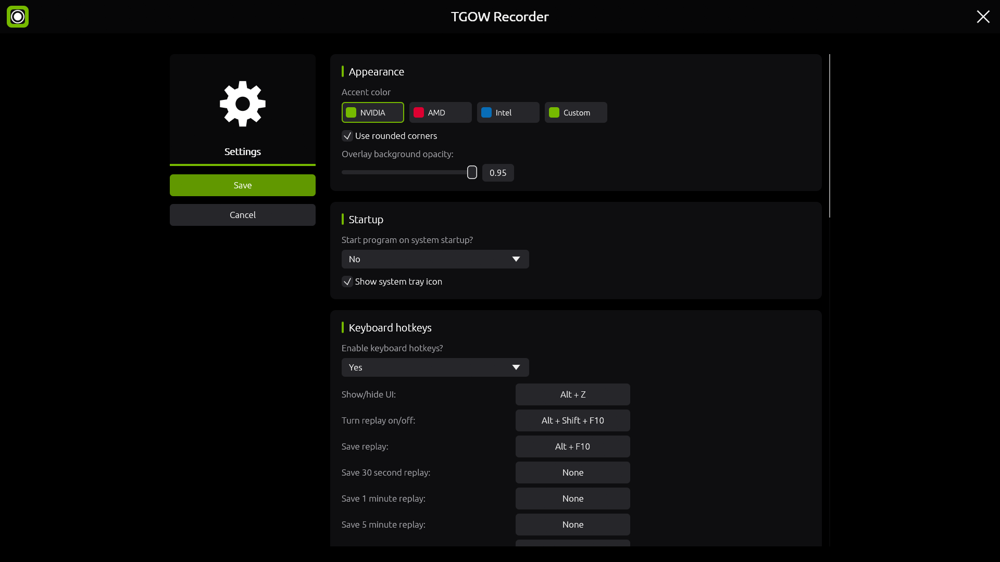
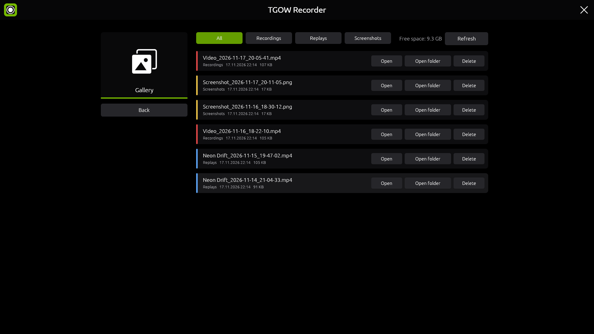

<p align="center">
  
</p>

<h1 align="center">TGOW Recorder</h1>

<p align="center">
  <b>Instant replay, recording, livestreaming and screenshots behind one hotkey; a ShadowPlay-style screen recorder, built in pure Rust.</b><br>
  Hardware encoding on NVIDIA, AMD and Intel, a fullscreen overlay, per-app audio tracks and a replay buffer in RAM or on disk,<br>
  in three small native programs for Windows and Linux. Free, offline, and yours.
</p>

<p align="center">
  
  
  
  
  <a href="https://github.com/T-G0W/tgow-recorder/releases/latest"></a>
  <a href="https://github.com/T-G0W/tgow-recorder/releases"></a>
  <a href="https://github.com/T-G0W/tgow-recorder/issues"></a>
  <a href="https://t-gow.com"></a>
  <a href="https://discord.gg/HpxtynMCFy"></a>
</p>

<p align="center">
  <a href="https://github.com/T-G0W/tgow-recorder/releases/latest"></a>
  &nbsp;
  <a href="https://github.com/T-G0W/tgow-recorder/releases/latest"></a>
</p>

<br>

<p align="center">
  
  <br>
  <sub>Press Alt+Z in any game or app: replay, record and stream are one click away, the panel turns green while it runs.</sub>
</p>

> [!NOTE]
> **TGOW Recorder is an independent project by T-GOW.** It is written from scratch in Rust and contains no code or artwork from
> NVIDIA ShadowPlay or GPU Screen Recorder, whose overlay style it follows.
> ShadowPlay is a trademark of NVIDIA; TGOW Recorder is not affiliated with or endorsed by NVIDIA or the GPU Screen Recorder project.

<p align="center">
  <a href="#features">Features</a> ·
  <a href="#feature-tour">Feature tour</a> ·
  <a href="#get-started">Get started</a> ·
  <a href="#hotkeys">Hotkeys</a> ·
  <a href="#command-line">Command line</a> ·
  <a href="#under-the-hood">Under the hood</a> ·
  <a href="#build-from-source">Build</a> ·
  <a href="#bugs-ideas-and-feedback">Feedback</a> ·
  <a href="#license-and-credits">License</a>
</p>

<br>

<table>
  <tr>
    <td width="25%" valign="top">
      <h3>⏪ Never miss a moment</h3>
      Instant replay keeps the last seconds or minutes of your screen in RAM or on disk. One hotkey saves the last 30 seconds, 1, 5 or 10 minutes, named after the game you are playing.
    </td>
    <td width="25%" valign="top">
      <h3>🎮 Made for games</h3>
      It knows when a Steam, Epic, GOG or Wine game is running, can switch replay on by itself and sorts clips into a folder per game. Controller hotkeys work from the couch.
    </td>
    <td width="25%" valign="top">
      <h3>⚡ The GPU does the work</h3>
      NVENC, AMF, Quick Sync, VA-API or Vulkan encode H264, HEVC and AV1, also in 10 bit. A multithreaded colour converter keeps a 1080p frame under 2&nbsp;ms on the CPU.
    </td>
    <td width="25%" valign="top">
      <h3>🔊 Every sound on its own track</h3>
      Mix your speakers, your microphone and single apps freely into several audio tracks, or record everything except Discord. A mute hotkey silences the mic in a second.
    </td>
  </tr>
</table>

<br>

## Features

Every screenshot is the real app, captured from a release build.

<table>
  <tr>
    <td width="50%" valign="top">
      
      <br>
      <sub>Instant Replay in the advanced view, with two audio tracks.</sub>
      <h3>Instant replay, your way</h3>
      Choose how long the buffer is, whether it lives in RAM or on disk and whether it restarts after saving. Saving never interrupts the buffer, so you can save twice in a row.
      <br><br>
      It can start with the computer, only on mains power, or whenever a game is running, and turn itself off again when the game closes.
    </td>
    <td width="50%" valign="top">
      
      <br>
      <sub>Recording settings in the simple view.</sub>
      <h3>Record whole sessions</h3>
      Capture a monitor, the monitor under the mouse, a window or a region you draw. Pause and resume, drop chapter markers, split long sessions into files of a fixed length or count down before it starts.
      <br><br>
      MP4 files are written so they stay playable even if the computer crashes during a recording.
    </td>
  </tr>
  <tr>
    <td width="50%" valign="top">
      
      <br>
      <sub>Go live on Twitch, YouTube, Kick, Rumble, WHIP or any RTMP or SRT server.</sub>
      <h3>Go live in one click</h3>
      Pick a service, paste your stream key and start. Constant bitrate, keyframe interval and codec are set up for streaming, and a custom server takes any RTMP, RTMPS, SRT or WHIP address.
    </td>
    <td width="50%" valign="top">
      
      <br>
      <sub>Screenshots as PNG or JPG, to disk, to the clipboard or both.</sub>
      <h3>Screenshots without the fuss</h3>
      A hotkey grabs the monitor, a window or a region. Copy it straight to the clipboard, open it in the program of your choice, or let the Scroll Lock light blink as a silent confirmation.
    </td>
  </tr>
  <tr>
    <td width="50%" valign="top">
      
      <br>
      <sub>Accent colour, startup, tray and every hotkey in one place.</sub>
      <h3>Looks the way you like</h3>
      Pick the green, red or blue accent of your graphics card or any colour, rounded or square corners and how dark the overlay gets. Every hotkey can be changed, cleared or reset, with a warning when two actions share a key.
      <br><br>
      The interface follows your system language: German on German systems, English everywhere else.
    </td>
    <td width="50%" valign="top">
      
      <br>
      <sub>The gallery lists recent clips and screenshots, filtered by type.</sub>
      <h3>Find your clips again</h3>
      The gallery shows what you recorded last, with size and date, and opens, reveals or deletes it. The free space on the target drive is always in view, and a warning shows up before the drive runs full.
    </td>
  </tr>
</table>

### Feature tour

- **Capture:** monitor, monitor under the mouse, focused window, a region you draw, or the desktop portal on Wayland; cursor on or off; resolution limit with high quality scaling; webcam picture-in-picture with position, size and mirroring.
- **Video:** H264, HEVC, AV1, VP8 and VP9; 10 bit and 4:4:4 where the GPU supports it; constant quality in four steps or a fixed bitrate; constant, variable or content-synced frame rate; limited or full colour range; MP4, MKV, MOV, WebM, FLV and MPEG-TS.
- **GPU encoders:** NVENC on NVIDIA, AMF on AMD, Quick Sync on Intel, VA-API on Linux and Vulkan Video everywhere, with a CPU fallback.
- **Audio:** Opus, AAC, FLAC or MP3; any number of tracks, each a mix of output devices, input devices and single applications, or every application except some; follows a change of your default device while recording.
- **Instant replay:** 2 seconds to 24 hours, in RAM or on disk, save the whole buffer or the last 30 seconds, 1, 5 or 10 minutes, restart on save.
- **Games:** detects Steam, Proton, Epic, GOG, Xbox and Wine games, names and sorts clips after them and can turn replay on while one runs.
- **Hotkeys:** keyboard hotkeys that work in fullscreen games, controller combos with the Home button, and a command for every action to bind in your own tools.
- **Everyday comfort:** system tray, start with the system, notifications, a countdown before recording, a microphone mute hotkey, a low disk space warning and the Scroll Lock light as a status indicator.

<br>

## Get started

**Windows 10 and 11**

1. Download **`tgow-recorder-<version>-windows-x64-setup.exe`** from the [releases page](https://github.com/T-G0W/tgow-recorder/releases/latest) and run it. No administrator rights needed. A portable ZIP is there as well.
2. Start **TGOW Recorder** from the start menu. The overlay opens and a green icon appears in the tray.
3. Press **Alt+Z** whenever you want the overlay, or use the hotkeys right away.

> [!TIP]
> Windows SmartScreen may show "Unknown publisher" the first time, because the setup is not signed with a paid code-signing certificate. Choose **More info › Run anyway**.

**Linux**

Pick the package for your distribution from the [releases page](https://github.com/T-G0W/tgow-recorder/releases/latest):

| Distribution | File | Install |
| --- | --- | --- |
| Arch Linux, CachyOS, EndeavourOS, Manjaro | `tgow-recorder-<version>-linux-x86_64.pkg.tar.zst` | `sudo pacman -U tgow-recorder-*.pkg.tar.zst` |
| Ubuntu 24.04 LTS and systems based on it, such as Linux Mint 22, Pop!_OS 24.04 and Zorin OS 18 | `tgow-recorder-<version>-linux-x86_64.deb` | `sudo apt install ./tgow-recorder-*.deb` |
| Any other, without root | `tgow-recorder-<version>-linux-x86_64.tar.gz` | unpack it and run `./tgow-recorder/install.sh` |

The archive installs into `~/.local` and brings its own uninstaller: `~/.local/share/tgow-recorder/install.sh --uninstall`. It is built on Arch Linux and needs FFmpeg 9 from your system.

Then start **TGOW Recorder** from your app menu. On Wayland the desktop asks once which screen to share and once to confirm the hotkeys. Screen capture on Wayland needs xdg-desktop-portal, audio needs PipeWire or PulseAudio.

Settings live in `%APPDATA%\T-GOW\tgow-recorder` on Windows and `~/.config/tgow-recorder` on Linux.

<br>

## Hotkeys

| Action | Default |
|---|---|
| Show or hide the overlay | `Alt` `Z` |
| Save replay | `Alt` `F10` |
| Turn replay on or off | `Alt` `Shift` `F10` |
| Start or stop recording | `Alt` `F9` |
| Pause or resume recording | `Alt` `F7` |
| Start or stop streaming | `Alt` `F8` |
| Take a screenshot | `Alt` `F1` |
| Screenshot of a region | `Alt` `Shift` `S` |

Saving 30 seconds, 1, 5 or 10 minutes, recording a region or window, the microphone mute and chapter markers have no key by default and can be set under **Settings › Keyboard hotkeys**.

With controller hotkeys on, hold the **Home** button and press **Start** for the overlay, **Y** for a screenshot, **D-pad up** to save a replay, **D-pad down** to record, **D-pad left** to turn replay on or off and **D-pad right** to save the last minute.

<br>

## Command line

Every action can be triggered from a terminal, a script or your desktop's own shortcut settings:

```bash
tgow-recorder ctl save-replay 30
```

```bash
tgow-recorder ctl toggle-record
```

`tgow-recorder ctl` without arguments lists all commands. The recorder itself also works on its own:

```bash
tgow-rec -w focused_monitor -f 60 -a default_output -a default_input -k hevc -o video.mp4
```

```bash
tgow-rec -w focused_monitor -r 120 -replay-storage ram -c mkv -o ~/Videos/Replays
```

While it runs it reads `save`, `save <seconds>`, `pause`, `resume`, `marker` and `stop` from its input. `tgow-rec --help` shows every option, `--list-monitors`, `--list-audio-devices` and `--list-application-audio` show what can be recorded, and `-v yes` prints frame rate and timings once per second.

<br>

## Under the hood

- **Three programs:** `tgow-recorder` is the background service with tray, hotkeys and notifications, `tgow-overlay` the fullscreen overlay, and `tgow-rec` the recorder, which the service starts and controls through its input and output.
- **UI:** [egui](https://github.com/emilk/egui) / eframe on OpenGL, with wgpu as fallback on Windows, every icon drawn as vectors in code.
- **Capture:** DXGI Desktop Duplication on Windows with GDI as fallback for remote sessions, the xdg-desktop-portal with PipeWire on Wayland and MIT-SHM on X11; Media Foundation and V4L2 for webcams.
- **Encoding:** [FFmpeg](https://ffmpeg.org) through [ffmpeg-next](https://github.com/zmwangx/rust-ffmpeg) for the encoders and muxers, and an own multithreaded BT.709 converter from RGB to NV12, P010 and YUV 4:4:4.
- **Audio:** WASAPI with process loopback on Windows, PulseAudio and PipeWire with per-application monitor streams on Linux, and a clock-driven mixer that keeps every track in sync with the picture.
- **Windows integration:** a tray icon with balloon notifications, `RegisterHotKey`, XInput, the Run key for autostart and an Inno Setup installer without administrator rights.
- **Linux integration:** StatusNotifierItem tray, global shortcuts through the desktop portal on Wayland and key grabs on X11, desktop notifications over D-Bus and gamepads through evdev.

<br>

## Build from source

Requirements: Rust (stable), FFmpeg 8 or newer with its development files, and clang for the FFmpeg bindings. On Linux also the PipeWire, PulseAudio, X11 and Wayland development files; on Windows the MSVC toolchain and a shared FFmpeg build in `FFMPEG_DIR`.

```bash
cargo build --release
```

```bash
cargo test --workspace
```

Cross-compiling the Windows build on Linux works with MinGW and a shared FFmpeg build for Windows (for example `ffmpeg-n9.0-latest-win64-lgpl-shared-9.0.zip` from BtbN/FFmpeg-Builds, unpacked to `~/ffmpeg-win`):

```bash
rustup target add x86_64-pc-windows-gnu
export FFMPEG_DIR=~/ffmpeg-win
export BINDGEN_EXTRA_CLANG_ARGS_x86_64_pc_windows_gnu="--target=x86_64-w64-mingw32 --sysroot=/usr/x86_64-w64-mingw32 -I/usr/x86_64-w64-mingw32/include -D__X86INTRIN_H -D__IMMINTRIN_H"
export CARGO_TARGET_X86_64_PC_WINDOWS_GNU_LINKER=x86_64-w64-mingw32-gcc
cargo build --release --target x86_64-pc-windows-gnu
```

Put `avcodec`, `avformat`, `avutil`, `swscale` and `swresample` from the FFmpeg `bin` folder next to the three executables.

Checks used in CI:

```bash
cargo fmt --all --check
cargo clippy --workspace --all-targets -- -D warnings
cargo xtask check
cargo xtask licenses --check
```

Pushing a tag such as `v0.1.0` builds the Windows setup, the portable ZIP, the Linux archive and the `.deb` and pacman packages and publishes the release on GitHub Actions. Running the release workflow by hand builds the same files as artifacts without publishing anything.

<br>

## Privacy

TGOW Recorder sends no telemetry and needs no account. It never goes online by itself; only a livestream you start sends your picture and sound to the service you picked. Recordings stay on your computer.

<br>

## Bugs, ideas and feedback

TGOW Recorder gets better with your feedback. Please use **[GitHub Issues](https://github.com/T-G0W/tgow-recorder/issues)** for everything you would like to see fixed, added or changed.

<p align="center">
  <a href="https://github.com/T-G0W/tgow-recorder/issues/new?template=bug_report.yml"></a>
  &nbsp;
  <a href="https://github.com/T-G0W/tgow-recorder/issues/new?template=feature_request.yml"></a>
</p>

- **Bugs:** what happened, what you expected, your system and graphics card, and what `tgow-rec` prints with `-v yes`.
- **Ideas and changes:** new features, things that feel awkward, missing codecs, services or hotkeys.
- Take a quick look at the [open issues](https://github.com/T-G0W/tgow-recorder/issues) first. If someone already asked for the same thing, a 👍 reaction is enough and helps to prioritise.

Questions and chat are welcome on [Discord](https://discord.gg/HpxtynMCFy). Issues are welcome in English or German.

<br>

## License and credits

TGOW Recorder is © 2026 T-GOW and dual-licensed under either of

- [MIT License](LICENSE-MIT)
- [Apache License, Version 2.0](LICENSE-APACHE)

at your option.

The Windows builds ship the shared FFmpeg libraries, built by [BtbN/FFmpeg-Builds](https://github.com/BtbN/FFmpeg-Builds) under the LGPL 2.1; the Linux builds use the FFmpeg of your system. The licenses of all libraries TGOW Recorder uses are collected in [`THIRD-PARTY-LICENSES.txt`](THIRD-PARTY-LICENSES.txt), generated with `cargo xtask licenses`.

<p align="center"><sub>Made with 🦀 by T-GOW · <a href="https://t-gow.com">t-gow.com</a> · <a href="https://discord.gg/HpxtynMCFy">Discord</a></sub></p>
